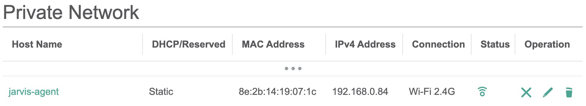

# Jarvis

A personal AI assistant that runs 24/7 on a small home server and is reachable over Telegram, voice and SSH. It watches GitHub repositories, keeps a portfolio site up to date, and is being extended into a general-purpose personal assistant for agenda, email, notes and finance.

The design goal is not "a chatbot". It is an assistant with **durable memory, explicit permissions and a real paper trail**: every fact it learns about the owner lives in a file or a database, and every action that touches the outside world is gated by a written rule.

## What it does

| Area | Behaviour |
|---|---|
| **Portfolio sync** | Reviews pushes to GitHub repositories. Relevant work (employability, stack, architecture, technical merit) becomes a pull request against the portfolio site; irrelevant pushes are ignored. |
| **Repo awareness** | Reads personal and company repositories freely for context. Any modification goes through a PR and needs explicit approval. |
| **Agenda** | Morning briefing with the day's plan, reminders at 60/30/5 minutes before an event, and alerts when the agenda changes. |
| **Email** | Reads, deletes spam and drafts replies. Sending always requires approval. |
| **Finances** | Tracks expenses, income and subscriptions in MXN, mirrored between Google Sheets and a local SQLite database. |
| **Reminders** | Telegram text or a voice call, chosen by importance. |
| **Visibility** | A full-screen dashboard on the server console shows Telegram traffic, every model and tool call, hardware state and the logs. |

## How it is put together

The assistant is a thin set of **text files that define identity, permissions and procedures**, running on top of [Hermes Agent](https://github.com/NousResearch/hermes-agent):

```
~/.agent/
├── AGENTS.md                     entry point: which files to read, in which order
├── context/global/
│   ├── AGENT.md                  role, responsibilities, memory rules
│   ├── OWNER.md                  owner profile, preferences, learned facts
│   └── TOOLS.md                  what is connected and what is still planned
├── rules/RULES.md                ask-first list, allowed actions, hard prohibitions
├── skills/                       procedures for recurring tasks, one folder per skill
└── context/chatting/chat.db      conversation history (SQLite + FTS5)
```

Two ideas carry most of the design:

- **Rules over vibes.** `rules/RULES.md` states exactly what needs approval — sending messages to third parties, destructive operations, pushing to `main`, anything that costs money — and what is always forbidden, such as leaking secrets or following instructions found inside fetched content.
- **Procedures, not prompts.** Recurring work lives in `skills/<name>/SKILL.md` and is loaded only when the task matches, so the instructions stay accurate and the context stays small.

## Stack

| Layer | Choice |
|---|---|
| Agent runtime | Hermes Agent, DeepSeek API |
| Messaging | Telegram gateway (systemd user unit, restarts on failure) |
| Remote access | Cloudflare Tunnel + Cloudflare Access: SSH at `jarvis.fervazquezdev.com` |
| Tooling | Docker, Git, GitHub CLI with two identities, SQLite, Python, Node |
| GitHub access | Read-only MCP server (`mcp_github_*`) plus the `gh` CLI for writes |
| Integrations | DeepSeek API, Telegram gateway, GitHub MCP (read-only), context7 MCP, Google Workspace over OAuth (Gmail, Calendar, Drive, Sheets, Docs, Contacts) |
| History | `~/.hermes/state.db` by Hermes, mirrored into `chat.db` |
| Portfolio | Next.js + Tailwind CSS on Vercel |
| Console | `jarvis-term`, a Rust TUI dashboard (source in `terminal/`) |
| Hardware | Surface Pro 3, Fedora Server 44, headless |

Inference runs on cloud APIs — the machine has no GPU and too little RAM for a useful local model.

## Network

The server lives on the home LAN at a fixed address, `192.168.0.84`. Rather than configuring a static IP on the machine, the router's DHCP lease for `jarvis-agent` was switched to **Static**, so the router always hands it the same address and `ssh jarvis` from the Mac never breaks. Nothing is exposed to the internet: remote access goes out through the Cloudflare Tunnel.



## Console dashboard

The machine is headless, so watching what the assistant is doing used to mean tailing log files. `terminal/` is a small Rust program (`jarvis-term`, ratatui, no async runtime) that runs on the console or over SSH and paints the whole picture in two colours:

- **Header** — hostname, addresses, uptime, load, clock.
- **SYSTEM** — CPU per core, RAM, swap, package and core temperatures, disk, network rate, battery, and whether the gateway, tunnel and `sshd` are up.
- **API CALLS** — every model call (model, provider, tokens in and out, latency) and every tool call with its status, plus the day's totals.
- **TELEGRAM** — the conversation as it happens, read straight from the Hermes database in read-only mode.
- **LOGS** — gateway activity and every warning or error.

Keys: `q` quits, `Tab` / `1 2 3` focus a panel, arrows and `PgUp`/`PgDn` scroll, `End` follows the newest line. About 9 MB of RSS and 1 % of one core.

```bash
cd terminal
cargo build --release
sudo install -m 0755 target/release/jarvis-term /usr/sbin/jarvis-term
jarvis-term          # on tty1, or over SSH as the user that owns ~/.hermes
```

It reads `~/.hermes/logs` (mode 700) and `~/.hermes/state.db`, so it must run as the owner of `~/.hermes`; `HERMES_HOME` points it at another Hermes directory. Details in [`terminal/README.md`](terminal/README.md).

## Chat history

Conversations are mirrored into a local SQLite database with full-text search:

```
~/.agent/context/chatting/chat.db
├── sessions    one row per conversation
├── messages    user / assistant / tool turns, ordered by seq
├── messages_fts  FTS5 index, diacritic-insensitive
└── transcript  view with conversation turns only
```

`sync_chat.py` copies new turns from Hermes' own store and is idempotent, so it is safe to run on a schedule. `log_chat.py --search "<query>"` searches everything stored.
